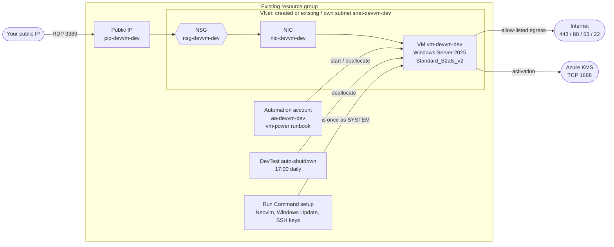

# FinOps 

OpenTofu for a low-cost, ephemeral Windows Server 2025 VM in Azure, deployed into an existing resource group. RDP restricted to your current public IP, UK working-hours schedule, Sunday 01:00 patching. Local state.

All OpenTofu code lives in `infra/`. Design decisions are recorded in [`docs/adrs/`](docs/adrs/README.md).

## Architecture



## Schedule (Europe/London)

| When | What | How |
|---|---|---|
| Mon-Fri 08:00 | Start VM | Automation runbook |
| Daily 17:00 | Deallocate VM | DevTest auto-shutdown |
| Sun 00:45 | Start VM for patching | Automation runbook |
| Sun 01:00 | Install updates + reboot | In-guest Windows Update policy |
| Sun 03:00 | Deallocate VM | Automation runbook |

Windows Update active hours are 08:00-17:00. Schedule start times get the correct UK offset (GMT or BST) automatically at apply time; Azure then keeps wall-clock times across DST changes. Set `enable_auto_start = false` to skip the Automation account (VM then never starts automatically or patches on Sunday). Details: [ADR 6](docs/adrs/0006-scheduling-and-patching.md).

## Cost

- Smallest workable burstable size (`Standard_B2als_v2`), HDD OS disk (64 GiB), no backups.
- Pay-as-you-go Windows Server licence, billed only while running; deallocated outside working hours.
- Optional `use_spot = true` for a further discount (VM may be evicted).
- Static public IP and OS disk are still billed while deallocated.

Details: [ADR 3](docs/adrs/0003-cost-optimisation.md).

## Network security

- Inbound: RDP 3389 from your IP only. Everything else denied.
- Outbound: 443, 80, 53 and 22 (`allow_ssh_outbound`) to the Internet, plus TCP 1688 to Azure KMS only. Everything else denied.
- VNet: dedicated VNet by default; set `create_vnet = false` and `vnet_name` to add the VM's own subnet to an existing VNet ([ADR 8](docs/adrs/0008-resource-group-and-vnet.md)).
- Sign-in: local admin account with a generated password ([ADR 5](docs/adrs/0005-local-admin-password-auth.md)).

Details: [ADR 4](docs/adrs/0004-network-security.md).

## Usage

```bash
az login
export ARM_SUBSCRIPTION_ID=$(az account show --query id -o tsv)
cd infra
cp terraform.tfvars.example terraform.tfvars   # set resource_group_name, admin_username
tofu init
tofu plan -out tf.tfplan
tofu apply tf.tfplan

tofu output public_ip
tofu output -raw admin_password
```

The resource group must already exist; resources use its location unless `location` is set. The deploying identity needs Owner or Role Based Access Control Administrator on the resource group (role assignment for the Automation identity). Details: [ADR 8](docs/adrs/0008-resource-group-and-vnet.md).

RDP to `public_ip` as `admin_username`, e.g. `xfreerdp /v:<ip> /u:<user> /dynamic-resolution`.

If your IP changes: `tofu apply` again (auto-detected via api.ipify.org) or set `allowed_ip`.

Start/stop manually: `az vm start|deallocate -g <resource_group_name> -n vm-devvm-dev`.

Tear down: `tofu destroy`. This removes only the resources OpenTofu created; the resource group and anything else in it are kept.

`terraform.tfstate` contains the admin password in plain text. Keep it local, never commit (gitignored).

## In-VM setup

- Neovim (`neovim_version`, from GitHub releases) at `C:\Program Files\Neovim\bin`.
- At first logon each user gets:
  - `~/.ssh/id_ed25519` - add `.pub` to GitHub.
  - `~/.ssh/id_rsa` (4096) - add `.pub` to Azure DevOps.
  - `~/.ssh/config` mapping each host to its key. Both use port 22.
- Keys have no passphrase (VM is ephemeral). Revoke them in GitHub / Azure DevOps when you destroy the VM.
- If `allow_ssh_outbound = false`, use HTTPS + Git Credential Manager instead.

Details: [ADR 7](docs/adrs/0007-in-guest-setup-run-command.md).

## Development

After each batch of changes:

```bash
cd infra
tofu fmt -recursive
tofu validate
trivy config .
```
